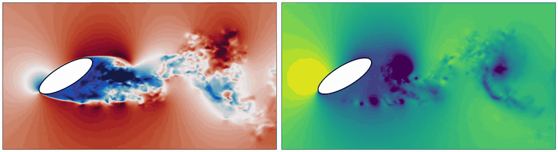
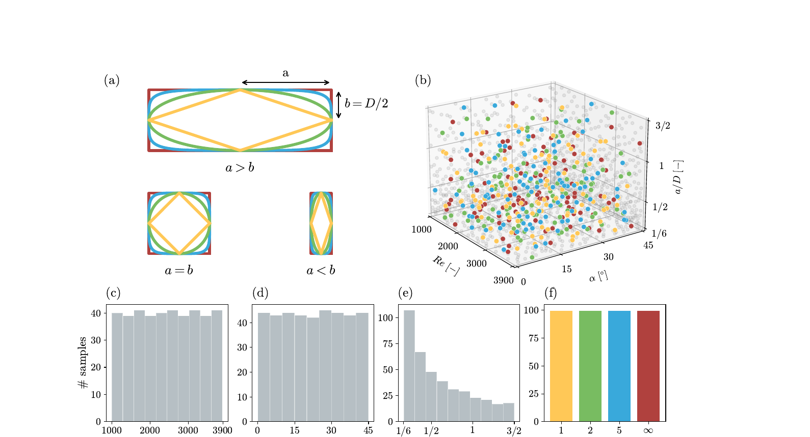

<div align="center">

# TurtLES

**A Large-Scale Benchmark for Turbulent 3D Neural PDE Surrogates**

NeurIPS 2026, Datasets and Benchmarks Track

[](PAPER_URL)
[](https://turtlesprojectml-alt.github.io)
[](https://huggingface.co/datasets/turtlesprojectml/turtles)
[](LICENSE)



<sub>Mid-span slices of the streamwise velocity (left) and pressure (right) of one
trajectory: elliptical cross-section (n = 2, a/D = 1.46), Re = 3101, angle of attack 31°.
The data itself is fully three-dimensional.</sub>

</div>

TurtLES is a 13 TB dataset of high-fidelity implicit large-eddy simulations of
three-dimensional turbulent cylinder wakes in the shear-layer transition regime. It
combines dense irregular meshes, long trajectories and turbulence with an active energy
cascade, and it comes with a benchmark of neural operators on long autoregressive
rollouts.

| | |
|---|---|
| **Trajectories** | 400 (320 train, 40 validation, 40 test), 400 time steps each |
| **Mesh** | irregular point clouds, 3 to 9 million nodes per frame |
| **Fields** | pressure `p`, density `rho`, velocity `u, v, w` |
| **Parameters** | super-ellipse geometry `(a, n)`, Reynolds number 1000 to 3900, angle of attack 0 to 45° |
| **Solver** | PyFR 2.0.3, 4th-order flux reconstruction, Mach 0.2 |
| **Size** | 13 TB, with smaller subsets from 5 GB |

This repository has everything around the dataset:

| Task | Command |
|---|---|
| Download the dataset or a subset | `turtles-data` |
| Train a model | `turtles-train` |
| Evaluate full-mesh autoregressive rollouts | `turtles-eval` |
| Build the paper's tables and spectra figure | `turtles-report` |
| Regenerate the data with Gmsh + PyFR | `turtles-gen` |

## Quick start

```bash
git clone <repository-url> TurtLES && cd TurtLES
pip install -e ".[gpu]"                              # Python >= 3.10, PyTorch >= 2.1

turtles-data download --subset debug                 # one trajectory, 5 GB, into data/turtles
turtles-train experiment=debug run_name=first-run    # 20 training steps
turtles-eval checkpoint=first-run                    # rollout + metrics in outputs/runs/first-run/eval
```

Two environment variables set the default locations (both optional):

```bash
export TURTLES_DATA_DIR=/path/to/turtles    # dataset root (default: data/turtles)
export TURTLES_OUTPUT_DIR=/path/to/outputs  # runs, checkpoints, logs (default: outputs)
```

## Installation

```bash
pip install -e .                  # core: data loading, training and evaluation (CPU or GPU)
pip install -e ".[gpu]"           # fused KNN (flashlib) and Triton kernels for CALM-PDE and UPT
pip install -e ".[gino]"          # GINO baseline (neuraloperator 1.x)
pip install -e ".[wandb]"         # Weights & Biases logging
pip install -e ".[generation]"    # data generation (PyFR is installed separately)
pip install -e ".[dev]"           # tests and linting
```

## Data

```bash
turtles-data size     --subset G1-T100                     # size on the hub before downloading
turtles-data download --subset G1-T100 --splits train val test
turtles-data info                                          # what is on disk
```

<p align="center"></p>

Subsets follow Appendix J of the paper. Geometry tiers `G1 ⊂ G2 ⊂ G3 ⊂ G4` add shape
families, temporal tiers `T100` to `T400` keep the first frames of every trajectory,
`full` is `G4-T400` and `debug` is a single reference trajectory. Training and
evaluation accept `data.source=hf` to download the missing files of the requested
subset on the fly.

One trajectory is a directory `Re{Re}_alpha{alpha}_a{a}_n{n}/` holding
`<case>_coords.h5` (`x`, `y`, `z`) and up to four 100-frame chunks `<case>_b0_99.h5`
to `<case>_b300_399.h5` (group `sol_t{t}` with `p, rho, u, v, w`). `stats.yaml` at the
dataset root holds the per-field statistics of the train split used for normalization.
From Python:

```python
from turtles.data import TurtlesData

data = TurtlesData({"root": "data/turtles", "subset": "G1-T100", "num_points": 524288})
windows = data.window_dataset("train", window=2)  # fields (2, N, 5), coords (N, 3), params (1,)
traj = data.trajectories("test")[0]
frames = data.frame_dataset(traj)  # one full-mesh (N, 5) frame at a time
```

## Training

```bash
turtles-train experiment=paper/calm_pde                          # paper protocol on this machine
turtles-train experiment=paper/upt optim.lr=3e-4 run_name=upt-lr3e-4
turtles-train experiment=paper/gino run_name=my-gino resume=true # continue from last.pt
```

`experiment=paper/<model>` reproduces the training protocol of the paper (Appendix L):
predict the increment to the next frame from one context frame, 524,288 sampled nodes
per step, effective batch 2, 100k AdamW steps with 5k warmup and cosine decay, bf16
autocast. Any other value of `src/turtles/configs/train.yaml` can be overridden on the
command line (Hydra syntax). Training logs `skill = 1 - loss / loss_persistence`, the
improvement over predicting no change: a run is learning when `skill` is positive and
rising.

Each run writes `config.yaml`, `last.pt` (for resuming) and `best.pt` (lowest
validation loss) to `$TURTLES_OUTPUT_DIR/runs/<run_name>/`. Weights & Biases logging
is enabled with `logging.wandb.enabled=true` (offline by default; upload later with
`wandb sync`).

### Several GPUs and clusters

`turtles-train` uses every process that `torchrun` or `srun` starts (one per GPU):

```bash
torchrun --nproc_per_node=4 -m turtles.cli.train experiment=paper/upt
```

On a SLURM cluster, copy and edit the scripts in `examples/slurm/` (account, partition,
environment), then submit them; the arguments go to the `turtles-*` command:

```bash
sbatch examples/slurm/train.sbatch experiment=paper/upt run_name=upt
sbatch examples/slurm/eval.sbatch checkpoint=upt
```

### Models

| `model=` | Paper name | Parameters |
|---|---|---|
| `calm_pde` | CALM-PDE | 45.1 M |
| `upt` | UPT | 62.0 M |
| `transolver` | Transolver++ | 21.8 M |
| `gino` | GINO | 3.1 M |
| `persistence`, `mean_field` | baselines | 0 |

Every model follows one interface (`src/turtles/models/base.py`):

```python
forward(context, coords, params=None, query_coords=None)
#   context (B, T_in, N, C), coords (B, N, 3), params (B, P) -> (B, Q, C) at query_coords
```

To add a model, write `src/turtles/models/<name>.py` with a `Config` dataclass and a
`Model(nn.Module)`, register it in `src/turtles/models/__init__.py` and add
`src/turtles/configs/model/<name>.yaml`.

## Evaluation

```bash
turtles-eval checkpoint=<run_name>                  # test split, 399 autoregressive steps
turtles-eval checkpoint=path/to/best.pt rollout.split=val
turtles-eval model=persistence                      # zero-parameter baseline
```

Each test trajectory is rolled out for 399 steps from its first frame on the full mesh.
The metrics follow Section 4 of the paper and are computed in physical units:

* **Rel-L2** and **VRMSE**, averaged over the five fields,
* **spectral band errors** of the spanwise spectrum of `u` (low, mid and high
  wavenumbers),
* the same metrics over the rollout windows of the paper, a divergence flag, and the
  inference cost in GPU-seconds per trajectory.

Results go to `<run_dir>/eval/<split>/` (`metrics.json`, `summary.md`, per-frame
records and figures). Collect several evaluations into the paper's tables:

```bash
turtles-report --eval UPT=outputs/runs/<upt_run>/eval/test \
               --eval Persistence=outputs/runs/persistence-baseline/eval/test \
               --out report/
```

## Data generation

`turtles-gen` reproduces the simulation campaign (Appendices F to H): a Sobol' design
of `(Re, alpha, a, n)`, Gmsh meshes, PyFR 2.0.3 implicit LES on 4 GPUs per case, the
stationarity check on the wake probes, and the conversion to the HDF5 layout above.

```bash
pip install -e ".[generation]"     # then install PyFR 2.0.3 in the same environment
cp src/turtles/configs/generation/pipeline.yaml pipeline.yaml   # set the directories
turtles-gen sample --n 1024 --out design.csv
turtles-gen setup  --design design.csv --config pipeline.yaml --n-cases 50
```

`setup` creates one directory per case with the mesh, the PyFR input files and the
settings. Each case then goes through four stages, each run with
`turtles-gen run <stage> <case_dir>`:

| Stage | What it does | Resources |
|---|---|---|
| `transient` | 4 flow-through times from the initial condition, then prints the stationarity statistic | 4 GPUs |
| `extend` | 5 more flow-through times; repeat until the statistic stays small | 4 GPUs |
| `trajectory` | records the 400 snapshots | 4 GPUs |
| `convert` | `.pyfrs` snapshots to HDF5 | CPU |

The solver stages start PyFR with `mpirun -n 4` (`mpi_launcher` in the settings,
or `--launcher`). On a SLURM cluster, submit them with
`examples/slurm/generate_stage.sbatch`:

```bash
sbatch examples/slurm/generate_stage.sbatch transient /path/to/turtles_cases/<case>
turtles-gen check /path/to/turtles_cases/<case>          # stationarity statistic again
turtles-gen status --design design.csv --config pipeline.yaml
turtles-data stats --root /path/to/turtles_dataset       # stats.yaml for the new data
```

## Repository layout

```
src/turtles/
  configs/      Hydra configs: train.yaml, eval.yaml, data/, model/, experiment/, generation/
  data/         dataset access, subsets, normalization, Hugging Face download
  models/       CALM-PDE, UPT, Transolver++, GINO, baselines, shared layers
  training/     trainer, schedules, checkpoints, multi-GPU setup
  evaluation/   rollouts, metrics, spectra, plots, report tables
  generation/   design sampling, meshing, PyFR inputs and stages, convergence check, conversion
  cli/          command-line entry points
examples/slurm/ example batch scripts for training, evaluation and data generation
tests/          CPU test suite on a small synthetic dataset
```

## Development

```bash
pip install -e ".[dev]" && pre-commit install
ruff check . && ruff format --check .
pytest                   # about a minute on CPU
pytest -m cuda           # GPU kernels, on a machine with CUDA
```

## Citation

If you use TurtLES, please cite:

```bibtex
@inproceedings{platenburg2026turtles,
  title     = {TurtLES: A Large-Scale Benchmark for Turbulent 3D Neural PDE Surrogates},
  author    = {Platenburg, Jarno and Kassa{\"i} Koupa{\"i}, Armand and Cinnella, Paola and Gallinari, Patrick},
  booktitle = {Advances in Neural Information Processing Systems, Datasets and Benchmarks Track},
  year      = {2026},
  url       = {PAPER_URL}
}
```

## License

The code is released under the [MIT License](LICENSE). See the
[dataset card](https://huggingface.co/datasets/turtlesprojectml/turtles) for the terms of
the data.
